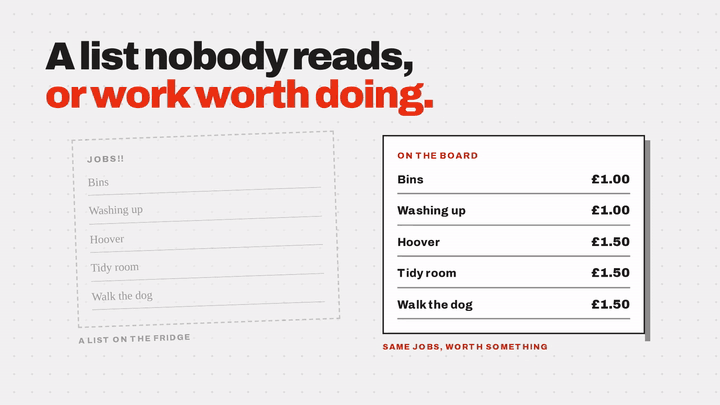
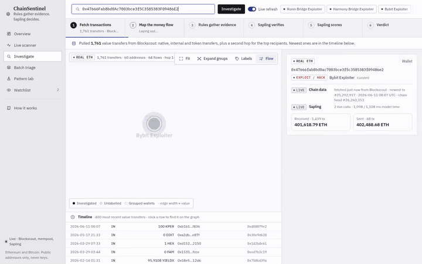

  

  
  
  

## About me

I'm a final-year Computer Systems Engineering student at Brunel University London. I like work where software meets something physical: PLCs moving pallets, microcontrollers driving displays, or a camera moving through a rainy street.

- **BMW Group:** Logistics Planning Intern (Controls & Automation), Jul 2025 - Sep 2026, programming PLC ladder logic in Siemens TIA Portal and WAGO e!COCKPIT for automated material flow.
- **Final-year project:** an AI model that sequences delivery routes at BMW Hams Hall to cut loading time and raise pallets per trip.
- **Before:** Data Analyst at **EY** (SAP Analytics Cloud) and Web Developer at **Cloud Nebula Enterprises** (Python, Dash).
- **On the side:** shipping [Pegboard](https://getpegboard.co.uk) and building animated scenes in Blender with Python.

## Hackathons

| Result | Event | Project |
|---|---|---|
| 🥇 1st | Mubit Night Shift, London, Oct 2026 (Best Use Case of Banyan Sapling) | [ChainSentinel](https://github.com/Ibad-10/Chainsentinel): traces Ethereum and Bitcoin wallets and flags money laundering against an AML policy |
| 🥇 1st | Brunel University Hack, Jul 2025 | [LuffaBot](https://github.com/Sahid-m/luffa-ai-bot): LangGraph agent that runs group votes and generates images from chat |
| 🥇 1st | Radix Hack, Jul 2025 | [StreamFlow](https://github.com/Sahid-m/radix-hack): creator tipping on the Radix blockchain |
| 🥇 1st | Encode AI London, Apr 2025 (main track + 2 bounties) | [Hack the Wallet](https://github.com/Sahid-m/HackTheWallet): talk an AI into returning locked crypto on Starknet |
| 🏁 Finalist | EasyA x Polkadot London, Apr 2025 | [Go Fish](https://github.com/Zohaib-Eh/GoFish): instant stablecoin payments for fish exporters |
| 🥉 3rd | Royal Hackaway v8, Feb 2025 | [Foodo-Baggins](https://github.com/Sahid-m/foodo_baggins): meal-photo nutrition tracker on Ollama |

## Featured work

<table>
  <tr>
    <td width="50%" valign="top">
      <h3><a href="https://getpegboard.co.uk">Pegboard</a></h3>
      A chore and pocket-money app for families. Parents post priced jobs, kids claim them with photo proof, parents approve from one queue. Installable PWA with a PIN kiosk mode for shared tablets.  
       
      <a href="assets/pegboard-demo.mp4"><strong>Watch the demo (with sound)</strong></a> · <a href="assets/pegboard-walkthrough.mp4">Full walkthrough</a>  
      
    </td>
    <td width="50%" valign="top">
      <h3><a href="https://github.com/Ibad-10/HookLine">Hookline</a></h3>
      Scam-spotting practice built from this week's real scam reports, for people of any age. Short lessons, practice calls where the AI caller answers what you actually say (a Gatekeeper stops the call if you start reading out a code), practice calls and emails to your real phone and inbox, and Sly, a cat mascot you can ask "is this a scam?". Ten AI jobs, all through the Mubit gateway, with small trained adapters. Built overnight at the Night Shift hackathon (Mubit), London, October 2026. <a href="https://hookline-one-iota.vercel.app">Try it</a>.  
       
      <a href="https://github.com/Ibad-10/HookLine/blob/main/docs/hookline-demo.mp4"><strong>Watch the demo (with sound)</strong></a>  
      
    </td>
  </tr>
  <tr>
    <td width="50%" valign="top">
      <h3><a href="https://github.com/Ibad-10/Chainsentinel">ChainSentinel</a></h3>
      Paste any Ethereum or Bitcoin wallet. It maps where the money went, runs 8 laundering checks, then Banyan Sapling judges it against an AML policy and returns FLAG, REVIEW or CLEAR. Won Best Use Case of Banyan Sapling at Mubit Night Shift, London, Oct 2026. <a href="https://chainsentinel-nine.vercel.app">Try it</a>.  
       
      <a href="https://github.com/Ibad-10/Chainsentinel/blob/main/docs/demo_silent.mp4"><strong>Watch the demo</strong></a>  
      
    </td>
    <td width="50%" valign="top">
      <h3>Embedded &amp; digital systems</h3>
      PIC16F18877 in assembly and XC8 C (multiplexed 7-segment, HD44780 LCD, ADC). A Verilog pulse generator on a MAX7000 CPLD. A Raspberry Pi Pico weather station with a REST API. An Arduino object-retrieval robot with 95% accuracy.  
      
    </td>
  </tr>
</table>

## Tech stack

**Web & apps** 

**Languages** 

**Hardware, 3D & tools** 

**Controls & industrial:** Siemens TIA Portal V17 · WAGO e!COCKPIT · PLC ladder logic · LabVIEW · Verilog HDL · Quartus · MPLAB X · Fusion 360 · PSPICE/OrCAD · Oracle APEX · SAP

## GitHub

  
  
   
  

